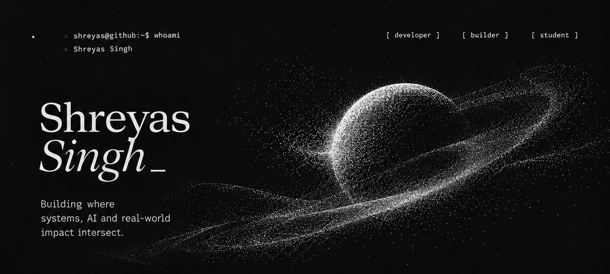
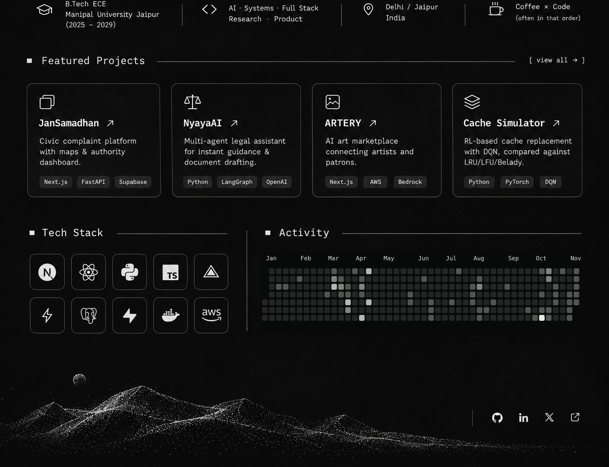

<!-- profile-artwork:start -->

<picture><source media="(prefers-reduced-motion: reduce)" srcset="assets/poster-576700f1946b.webp"></picture>

<!-- profile-artwork:end -->

Project & contact links

- [JanSamadhan — civic complaint platform](https://github.com/shryssssss-maker/ps-crmdev1) · [Live project](https://jansamadhan.perkkk.dev)
- [NyayaAI — multi-agent legal assistance](https://github.com/shryssssss-maker/NyayAI)
- [ARTERY — AI-assisted art marketplace](https://github.com/shryssssss-maker/ARTERY)
- [Adaptive Cache Simulator — reinforcement learning for cache replacement](https://github.com/shryssssss-maker/cache-simulator)
- [All repositories](https://github.com/shryssssss-maker?tab=repositories)
- [LinkedIn](https://www.linkedin.com/in/shreyas-singh-bbbb20384) · [Email](mailto:shreyassingh265@gmail.com)

Tech stack: Next.js, React, Python, TypeScript, Vercel, FastAPI, PostgreSQL, Supabase, Docker and AWS.

