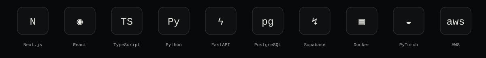
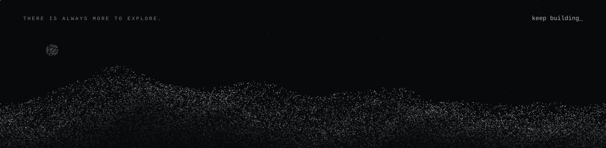

<!-- Original, self-contained particle artwork. No tracking or image widgets. -->
<picture>
  <source media="(max-width: 600px)" srcset="assets/orbital-hero-mobile.svg">
  
</picture>

  <a href="https://www.linkedin.com/in/shreyas-singh-bbbb20384">LinkedIn ↗</a>&nbsp;&nbsp; · &nbsp;&nbsp;
  <a href="mailto:shreyassingh265@gmail.com">Say hello ↗</a>&nbsp;&nbsp; · &nbsp;&nbsp;
  <a href="https://github.com/shryssssss-maker?tab=repositories">Explore my repositories ↗</a>

### ▪ Selected work

<table>
<tr>
<td width="50%" valign="top">

#### [01 / JanSamadhan ↗](https://github.com/shryssssss-maker/ps-crmdev1)

Civic tech connecting citizens, authorities and field workers through map-based reporting and four purpose-built portals.

UI/UX, gamification and worker flows · Team 404

`Next.js` `FastAPI` `Supabase`

[Live project ↗](https://jansamadhan.perkkk.dev)

</td>
<td width="50%" valign="top">

#### [02 / NyayaAI ↗](https://github.com/shryssssss-maker/NyayAI)

A team-built legal assistance platform with a multi-agent pipeline and dedicated citizen and lawyer experiences.

Drafting & explainability agents · Portal design

`Python` `LangGraph` `Next.js`

[Explore the project ↗](https://github.com/shryssssss-maker/NyayAI)

</td>
</tr>
<tr>
<td width="50%" valign="top">

#### [03 / ARTERY ↗](https://github.com/shryssssss-maker/ARTERY)

An AI-assisted art marketplace connecting Indian artisans with patrons through discovery, curation and custom commissions.

Art meets intelligent discovery

`Next.js` `AWS` `Bedrock`

[Explore the project ↗](https://github.com/shryssssss-maker/ARTERY)

</td>
<td width="50%" valign="top">

#### [04 / Adaptive Cache Simulator ↗](https://github.com/shryssssss-maker/cache-simulator)

Teaching a Deep Q-Network to choose L2 cache evictions, then benchmarking it against FIFO, LRU, LFU and Belady.

Systems research · Reinforcement learning

`Python` `PyTorch` `DQN`

[Experiments & results ↗](https://github.com/shryssssss-maker/cache-simulator#experiments--results)

</td>
</tr>
</table>

### ▪ Tools I build with

Currently exploring reinforcement learning, intelligent systems and the space between good engineering and useful products.

  <a href="https://github.com/shryssssss-maker/rocket-league-ml-bot">Also in the lab: a Rocket League RL bot ↗</a>

